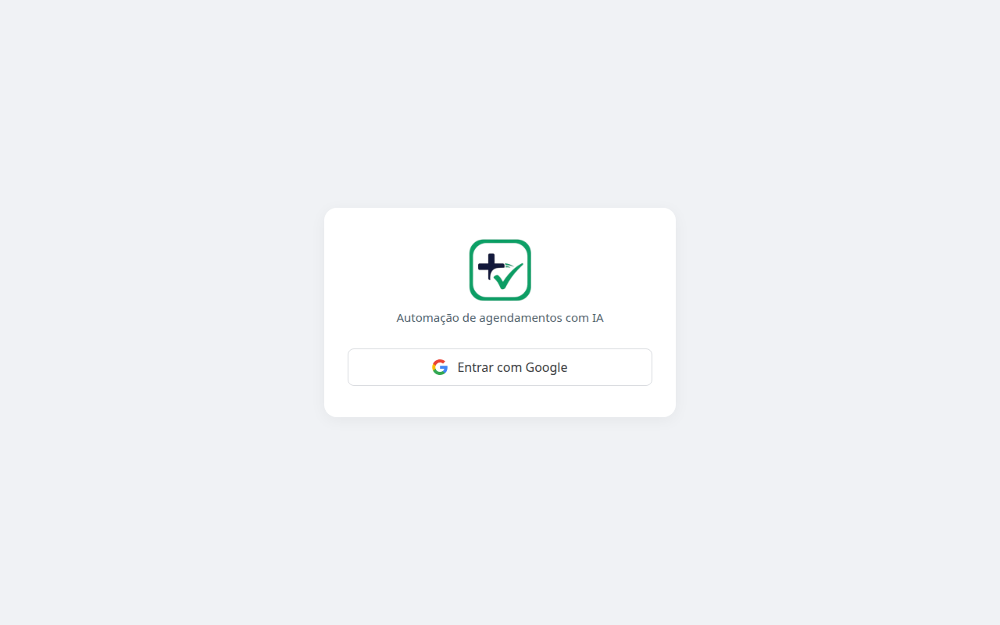
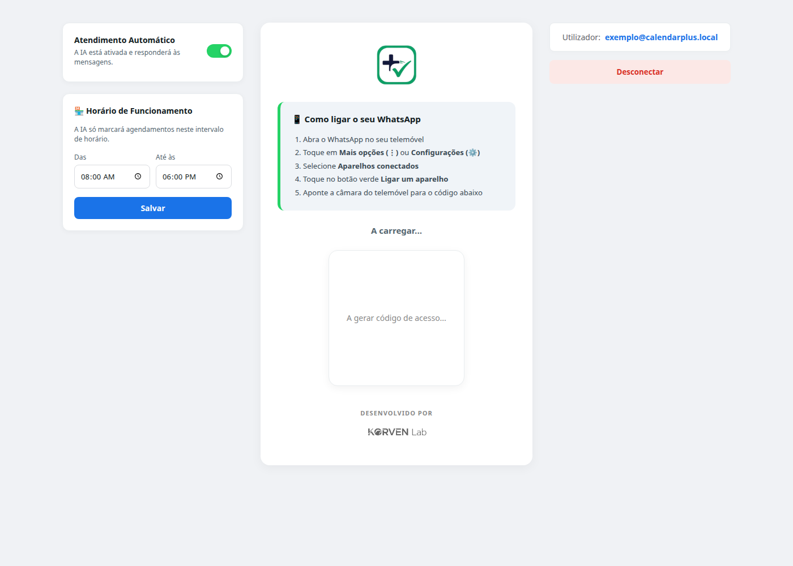

# Calendar Plus — painel

Painel em que o profissional conecta a conta Google e o WhatsApp para o Calendar Plus marcar horários. Depois do login, a tela gera o QR Code da sessão, deixa definir o intervalo em que a IA pode agendar e permite ligar ou desligar essa automação.

Feito em React, TypeScript e Vite, com Socket.IO para o QR Code e o status da sessão. A API vem da variável `VITE_API_URL`.

## Demo

Não há demo pública.

O endereço `https://calendarplus-frontend.vercel.app` responde 404. A Vercel devolve `DEPLOYMENT_NOT_FOUND`: esse host não tem deployment. O mesmo endereço está no campo Website do repositório.

O deploy que existe está no projeto Vercel `calendarplus-login` (time `kleidson-almeida-santos-projects`). O alias `https://calendarplus-login-kleidson-almeida-santos-projects.vercel.app` redireciona para o login da Vercel (`vercel.com/sso-api`), então um visitante não abre o painel. As imagens abaixo são deste repositório, com `npm run build` e `npm run preview`, sem API.



A tela de entrada é o que abre em `/`. Sem `VITE_API_URL`, o botão "Entrar com Google" mostra o aviso "Erro de configuração: URL da API não definida."



O painel aparece quando a URL traz `clientId`. Na captura, `exemplo@calendarplus.local` é só um exemplo local, não uma conta conectada. Sem a API, a sessão não inicia, o QR Code não é gerado e o status fica em "A carregar...".

## Como rodar

```bash
npm install
npm run dev
```

Crie um `.env` na raiz:

```
VITE_API_URL=https://sua-api
```

O Vite grava `VITE_API_URL` no build e no servidor de desenvolvimento. Trocar o valor exige reiniciar o `dev` ou rodar `npm run build` de novo.

Com a API no ar, o login Google devolve o `clientId` na URL. Para abrir só o layout do painel, use `http://localhost:5173/?clientId=seu-id`. Horário, interruptor da IA e QR Code dependem da API.

## Publicar na Vercel

`npm run build` gera a pasta `dist`. No projeto: framework Vite, comando de build `npm run build`, diretório de saída `dist`. Defina `VITE_API_URL` em Production e faça um novo deploy. O link só serve para visita pública se o deployment de produção não exigir login da Vercel.
